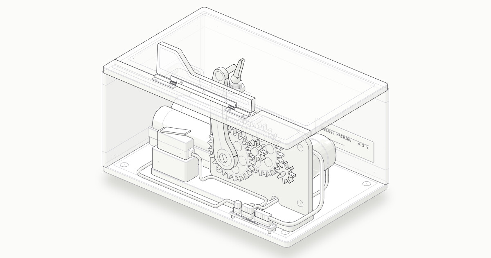

# Useless machine

[](https://franbrizuelab.github.io/useless-machine/)

An interactive isometric cutaway of a useless machine: flip the toggle and an arm pushes a door open in the lid,
flips the switch back off and retracts. Built with the `anatomy` figure kit.

**Live:** https://franbrizuelab.github.io/useless-machine/

Each page is a single standalone HTML file:

- `useless-machine-v3-light.html`: current version (`index.html` opens it)
- `useless-machine-v2-light.html`: lid door, fixed circuit, per-axis take-apart, wiring
- `useless-machine-light.html`: v1

## Build

The build reads the kit from `~/.claude/skills/anatomy`.

```sh
node build.mjs            # v1
node build.mjs --v2       # v2
node build.mjs --v3       # v3
```

Add `--cached` to reuse the saved painter's keys (`keys*.json`) instead of settling them again (about 3 minutes for
v2 and v3), and `--audit` to check the geometry.

## Link preview

`preview.jpg` (1200 × 630) is the image chat apps and social sites show for the link; `index.html` and the v3 page
point to it with Open Graph tags. To redraw it after a change:

```sh
node ~/.claude/skills/anatomy/scripts/drive.mjs useless-machine-v3-light.html --actions dev/steps-preview.json
magick shots/v3/og-raw.png -strip -quality 90 -sampling-factor 4:4:4 preview.jpg
```
